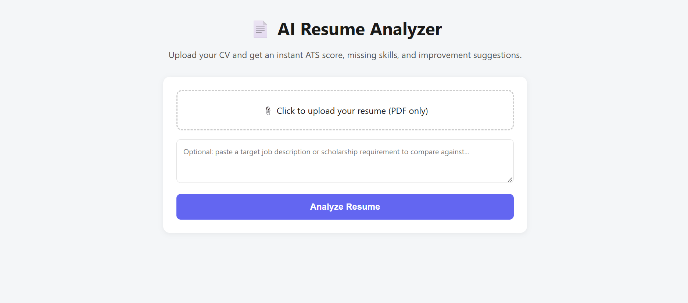
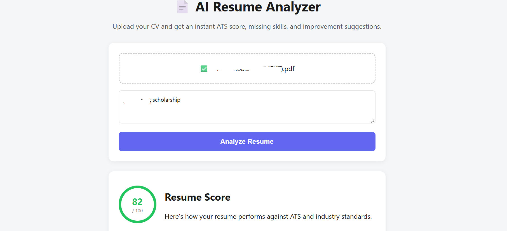
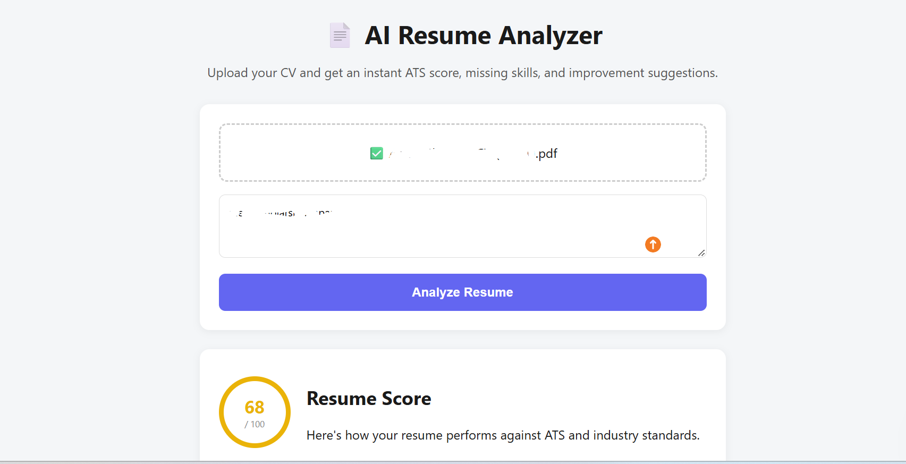

# AI Resume Analyzer

A full-stack MERN application that analyzes resumes with an AI model (Google Gemini) and provides:

- ATS compatibility score (0-100)
- Strengths and missing skills detection
- ATS formatting issues
- Actionable improvement suggestions
- Optional job/scholarship description matching

**Live demo:** https://ai-resume-analyzer-tau-gules.vercel.app
(The backend runs on Render's free tier, so the first request may take 30-60 seconds to wake up.)





## Tech Stack

- **Frontend**: React
- **Backend**: Node.js, Express
- **AI**: Google Gemini API (`gemini-3.5-flash` by default, configurable with the `GEMINI_MODEL` environment variable)
- **PDF Parsing**: pdf-parse
- **File Upload**: Multer
- **Deployment**: Vercel (frontend), Render (backend)

## Prerequisites

- Node.js v18+ installed
- A free Gemini API key from [https://aistudio.google.com/app/apikey](https://aistudio.google.com/app/apikey)

## Setup Instructions

### 1. Get your Gemini API key

Go to [https://aistudio.google.com/app/apikey](https://aistudio.google.com/app/apikey), sign in with Google, and click "Create API key". Copy it.

### 2. Backend Setup

```
cd backend
npm install
cp .env.example .env
```

Open `.env` and paste your API key:

```
PORT=5000
GEMINI_API_KEY=your_actual_key_here
# Optional: override the default model
GEMINI_MODEL=gemini-3.5-flash
```

Run the backend:

```
npm start
```

You should see: `Server running on http://localhost:5000`

### 3. Frontend Setup

Open a new terminal:

```
cd frontend
npm install
npm start
```

This opens the app automatically at `http://localhost:3000`.

### 4. Test it

Upload any resume PDF and click "Analyze Resume". Within a few seconds you will see the score and breakdown.

## How It Works

1. The user uploads a PDF resume (optionally with a target job/scholarship description).
2. The backend extracts the text from the PDF (`pdf-parse`).
3. The text is sent to the Gemini API with a structured prompt that asks for a JSON response (score, strengths, missing skills, ATS issues, suggestions).
4. The JSON result is returned to the React frontend and displayed.

## Project Structure

```
ai-resume-analyzer/
├── backend/
│   ├── server.js              # Express server & routes
│   ├── utils/
│   │   ├── extractText.js     # PDF text extraction
│   │   └── analyzeResume.js   # Gemini AI analysis logic
│   ├── uploads/               # Temp storage for uploaded PDFs (auto-cleaned)
│   ├── .env.example
│   └── package.json
├── frontend/
│   ├── src/
│   │   ├── App.js             # Main UI component
│   │   ├── App.css
│   │   ├── index.js
│   │   └── index.css
│   ├── public/
│   │   └── index.html
│   └── package.json
└── README.md
```

## Deployment (Free options)

- **Frontend**: Deploy to [Vercel](https://vercel.com). Connect your GitHub repo, set the root directory to `frontend`.
- **Backend**: Deploy to [Render](https://render.com). Create a new "Web Service", connect the repo, set the root directory to `backend`, and add `GEMINI_API_KEY` (and optionally `GEMINI_MODEL`) as environment variables.
- After deploying the backend, set `REACT_APP_API_URL` in the frontend environment variables (Vercel dashboard) to your Render backend URL.

## Limitations

- Analysis is performed by an external LLM (Google Gemini API); no model is trained in this project.
- Resume text is sent to Google's Gemini API for analysis.
- Scores and suggestions are AI-generated guidance, not an official ATS result.
- Only text-based PDFs are supported; scanned image PDFs cannot be parsed.

## Future Improvements

- User authentication and resume history (MongoDB)
- Multi-language resume support
- Export analysis as a downloadable PDF report
- Resume version comparison (before/after score tracking)

## Author

Amna Shoaib, BS Information Technology, MNS University of Agriculture, Multan, Pakistan

GitHub: [@amnashoaib2510-cloud](https://github.com/amnashoaib2510-cloud)
